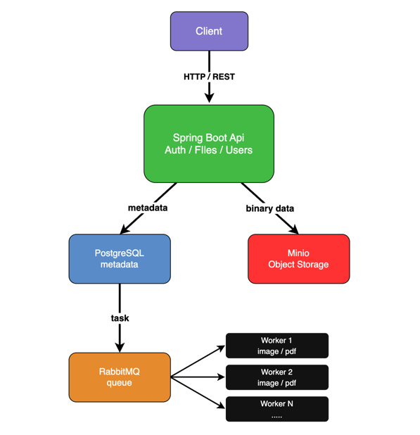

# Distributed File Storage and Processing System

A diploma project for storing files, managing file metadata, and processing uploaded files asynchronously through independently running workers.

## Problem statement and target users

File uploads can trigger expensive operations such as metadata extraction and image processing. Performing these operations within an upload request increases response time and ties processing capacity to the API service. The project aims to separate file management from background processing and demonstrate how queued work can be distributed across multiple workers.

The intended users are people who need to upload, download, and organize files, and developers who need a file management and processing API for their applications. These target-user needs are initial assumptions to be validated during requirements analysis.

## Aim, objectives, and expected outcomes

The aim is to develop a backend system that provides a single API for file management and supports scalable, fault-tolerant asynchronous file processing.

The project objectives are to:

- Implement upload, download, file and folder organization, validation, and authorization through a Spring Boot API.
- Store binary contents and generated artifacts in MinIO, and metadata and processing state in PostgreSQL.
- Distribute background jobs through RabbitMQ to independent workers, including retries and recovery after worker failures.
- Demonstrate horizontal worker scaling and asynchronous processing under a controlled workload.
- Prepare containerized deployment, Kubernetes configuration, monitoring, and automated verification.

Expected outcomes include a working backend prototype, reproducible deployment configurations, project documentation and diagrams, automated tests, and evaluation results showing processing throughput, completion time, and recovery behavior as worker count and failure conditions change. These are planned deliverables, not claims of completed functionality.

## Team and supervisor

| Team member         | Group | Role and responsibilities |
|---------------------|---|---|
| Kassymov Abilmansur | SE-2404 | QA and DevOps engineer: Docker configurations for services, Kubernetes cluster setup for application fault tolerance, Prometheus and Grafana monitoring, and Selenium testing where a browser-based scenario is available. |
| Amangeldiev Abdunur | SE-2404 | Backend developer: implementation of the file management API, metadata operations, storage integration, and asynchronous processing logic. |

**Supervisor:** Khaimuldin Askar

## Project scope

The term **distributed** refers to the overall application architecture and its distributed processing capabilities, not the physical distribution of stored files. The project focuses on **distributed file processing, NOT distributed physical storage**.

### In scope

- File upload, download, organization, metadata management, and authorization.
- A single MinIO storage service for original files and generated artifacts.
- Asynchronous metadata extraction, image processing, and background job status tracking.
- Multiple independently running workers that can scale horizontally.
- RabbitMQ coordination of task distribution, retries, and failure recovery, with application and worker logic handling these behaviors.
- Demonstrations of worker scalability, fault tolerance, and asynchronous processing.
- Docker-based local deployment, Kubernetes deployment of application components, monitoring, and testing.

### Out of scope

- Distributed physical file storage clusters.
- Storage replication, sharding, and custom storage algorithms.
- Using Kubernetes to introduce distributed MinIO storage or claim storage-layer fault tolerance.

## Current development status

The project is at the initial analysis, design, and application scaffolding stage. The repository currently contains:

- A Java 21 Spring Boot application skeleton and Maven Wrapper.
- Basic application configuration and a Spring application-context test.
- An initial architecture diagram and this project overview.

The file API, PostgreSQL/MinIO/RabbitMQ integrations, workers, Docker and Kubernetes configurations, monitoring, and functional/performance test suites are planned. The current skeleton has no REST endpoints or file-processing functionality and is not yet a runnable end-to-end prototype.

## Architecture

Binary file contents are stored in S3-compatible MinIO storage, while PostgreSQL stores metadata and processing state. RabbitMQ dispatches background jobs to independent workers so that expensive processing does not block an upload request. Workers read the required objects, perform processing, save generated artifacts, and update processing state.



### Selected technologies and components

| Component or technology | Responsibility |
|---|---|
| Java 21, Spring Boot, Maven | Backend platform and build tooling; planned REST endpoints, validation, authorization, and upload/download coordination |
| PostgreSQL | Users, file and folder metadata, object keys, processing status, and timestamps |
| MinIO | Single storage service for binary file contents and generated artifacts such as thumbnails |
| RabbitMQ | Queueing and distributing processing tasks, supporting retries and failure recovery |
| Worker service | Metadata extraction, image processing, and other background jobs; independently scalable instances |
| Docker / Docker Compose | Service containers and local development environment |
| Kubernetes | Planned deployment and recovery of application components and horizontal worker scaling |
| Prometheus / Grafana | Planned metrics collection and dashboards |
| JUnit / Spring Boot Test | Application-context test scaffold and planned backend automated tests |
| k6 | Planned API load and performance testing |
| Selenium | Planned browser-based testing where an applicable user interface is available; the current scope centers on the backend API |

### Architecture decisions

- PostgreSQL stores metadata rather than main file bytes, separating relational queries from binary object storage.
- The API records MinIO object keys in PostgreSQL to locate stored files and generated artifacts.
- RabbitMQ separates upload requests from long-running processing. The planned API returns a file/job identifier while workers process jobs asynchronously.
- The API and workers have separate responsibilities, allowing worker capacity to scale independently of API capacity.
- Docker Compose will support local development. Kubernetes is planned to demonstrate application and worker recovery and scaling; MinIO remains a single storage service.

These are design intentions. Implementation details may evolve through experiments while preserving the scope constraints above.

## Setup, execution, and testing

### Current application skeleton

Prerequisites: JDK 21 and network access to the Maven distribution and dependency repositories on the first build. Run the following commands from the repository root (use `mvnw.cmd` instead of `./mvnw` on Windows).

Build the application:

```bash
./mvnw clean package
```

Run the application skeleton:

```bash
./mvnw spring-boot:run
```

The current application includes only the base Spring Boot starter, so it does not expose an HTTP server or API and may exit after initialization. Infrastructure services are not yet required or configured.

Run the existing application-context test:

```bash
./mvnw test
```

This test checks Spring context initialization only. It does not verify uploads, storage, queues, worker recovery, or performance. Full service configuration, environment-variable examples, and end-to-end execution instructions will be added with the corresponding implementation. Credentials must be supplied through local configuration or environment variables and must not be committed.

## Verification and evaluation plan

The planned evaluation will cover:

| Area | Planned verification and evidence |
|---|---|
| File management | API tests for upload/download content integrity, metadata, folder operations, validation, and authorization |
| Asynchronous processing | Verify that upload handling returns before background processing completes, and that job state and generated artifacts can be retrieved |
| Worker scalability | Compare a one-worker baseline with multiple workers using the same files, processing operations, infrastructure resources, and workload; record throughput, completion times, queue depth, and resource usage |
| Failure recovery | Stop a worker during processing and check task redelivery/retry, eventual job completion or an explicit terminal failure, and consistency of metadata and generated artifacts |
| Deployment and observability | Verify reproducible service startup, worker recovery in Kubernetes, and visibility of service/worker metrics in Prometheus and Grafana |

Mandatory requirements, numerical acceptance thresholds, workload sizes, retry limits, and measurement conditions still need to be specified before evaluation. No benchmark results or verified user-study findings are available yet.

