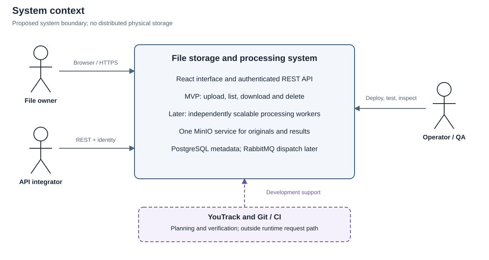
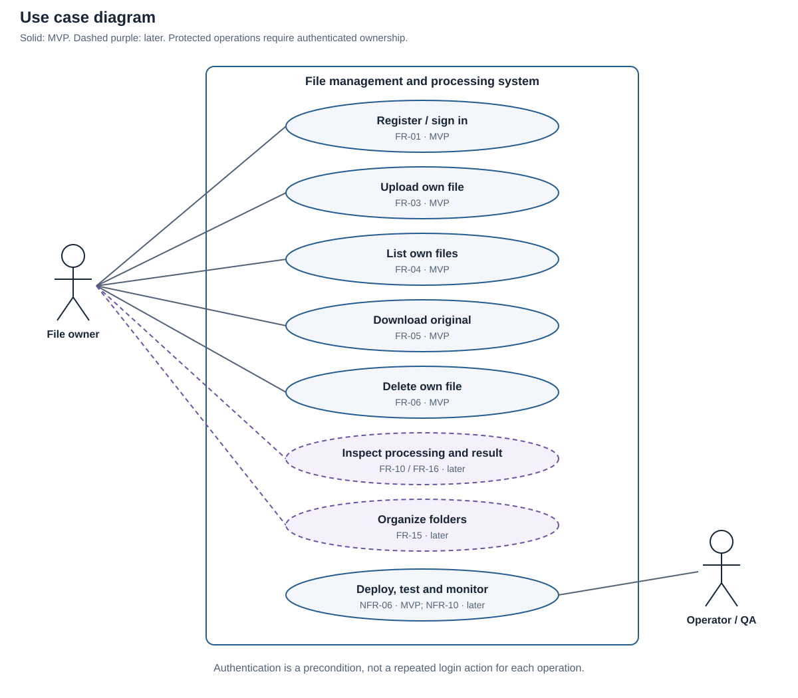
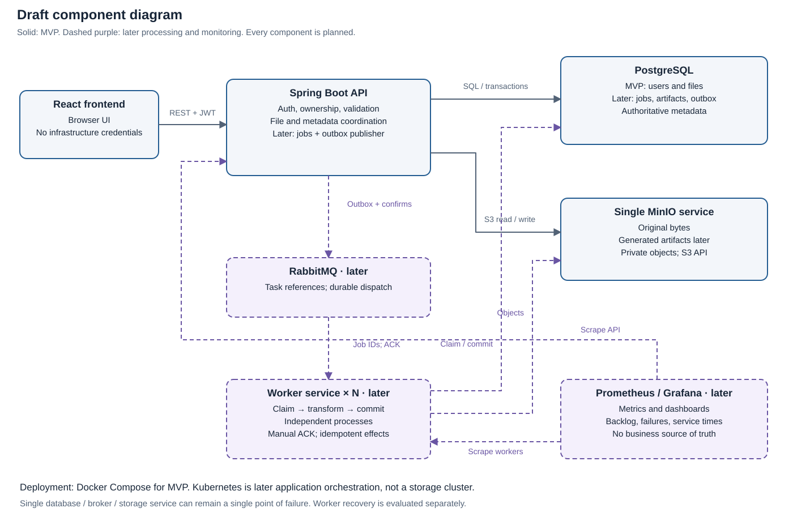
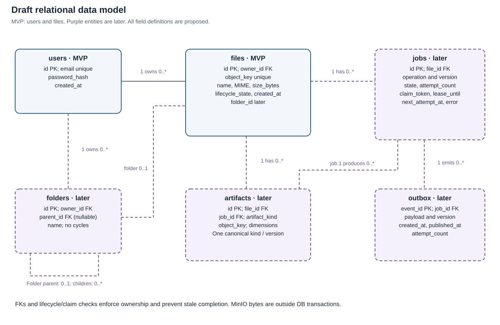
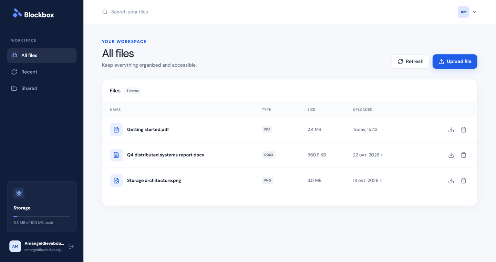

# Distributed File Storage and Processing System

## Analysis and design report

**Version:** 1.0 · **Date:** 22 October 2026 · **Language:** English  
**Authors:** Kassymov Abilmansur and Amangeldiev Abdunur, SE-2404  
**Supervisor:** Khaimuldin Askar  
**Project tracker:** [Diploma Project — DP](https://a2dev.youtrack.cloud/projects/DP)

This report covers the required assessment components. The project will provide a web interface and API for file management, then add asynchronous processing by independently scalable workers. **The distributed part is file processing. File contents reside in one MinIO storage service; distributed physical storage is outside the project.**

The repository currently contains a Java 21 / Spring Boot skeleton, basic configuration, an application-context test, and an initial architecture image. The first working MVP is planned for **22 November 2026**.


### Contents

1. [Project proposal](#1-project-proposal)
2. [Evidence of relevance](#2-evidence-of-relevance)
3. [Literature review](#3-literature-review)
4. [Existing system comparison](#4-existing-system-comparison)
5. [Technology comparison](#5-technology-comparison)
6. [Requirements specification](#6-requirements-specification)
7. [Architecture and diagrams](#7-architecture-and-diagrams)
8. [UX and prototype](#8-ux-and-prototype)
9. [Verification and evaluation plan](#9-verification-and-evaluation-plan)
10. [Project management and risks](#10-project-management-and-risks)
11. [Supervisor feedback](#11-supervisor-feedback)

## 1 Project proposal

### 1.1 Problem and intended users

A file upload may be followed by CPU- or I/O-intensive work such as image resizing or metadata extraction. Executing that work inside the upload request couples API response time and capacity to processing demand. Moving it to background workers separates request handling from processing, but introduces coordination problems: durable job registration, duplicate delivery, partial failures, result consistency, and capacity limits.

The proposed application addresses these problems through a file-management API, a relational metadata store, a single object-storage service, and a queue-backed processing layer. It is an engineering and evaluation project, not a claim that existing file-management products lack these capabilities.

| Intended user | Need to validate | Proposed interaction |
|---|---|---|
| Individual file owner, initially students and small-team members | Store and retrieve documents/images without exposing other users' files | Register, sign in, upload, list, download, delete; later organize folders and inspect processing results |
| Application developer | Integrate file operations and observe asynchronous outcomes | Authenticated REST API with stable file/job identifiers and explicit errors |
| Operator or QA engineer | Reproduce deployment, diagnose failures, and adjust processing capacity | Docker environment, logs, later metrics and worker scaling |

These user categories are hypotheses. No external client agreement or completed interviews are available.

### 1.2 Aim and objectives

**Aim:** develop and evaluate a web application that securely manages files and distributes asynchronous file-processing jobs across independent workers.

| Objective | Expected deliverable | Evidence of achievement |
|---|---|---|
| O1 Provide a usable file-management flow | React UI and authenticated Spring Boot REST API | Browser demonstration and API tests |
| O2 Separate file bytes from metadata | MinIO adapter, PostgreSQL schema, migrations | Integrity, ownership, and partial-failure tests |
| O3 Distribute processing independently of HTTP requests | RabbitMQ integration and worker application | Multiple worker identities consuming distinct jobs |
| O4 Recover from worker failures without duplicate visible results | Job state machine, retry policy, idempotent result publication | Controlled kill/redelivery and duplicate-message tests |
| O5 Measure scaling and architectural trade-offs | Reproducible workloads, scripts, raw measurements and charts | One-, two-, and four-worker comparisons and documented bottlenecks |
| O6 Make the solution reproducible and reviewable | Containers, CI, tests, diagrams, operating instructions | Clean deployment, successful CI, reviewed changes and tagged submissions |

### 1.3 Team and scope

| Team member | Group | Responsibility |
|---|---|---|
| Касымов Абилмансур Кайратулы / Kassymov Abilmansur | SE-2404 | QA and DevOps: Docker service configuration, test planning, Selenium, CI, later Kubernetes deployment and Prometheus/Grafana |
| Амангелдиев Абдунур Элнурович / Amangeldiev Abdunur | SE-2404 | Backend: authentication, REST API, metadata, storage integration, job orchestration and processing logic |


**MVP scope:** registration/login, JWT-protected API, upload/list/download/delete of the owner's files, React screens, PostgreSQL metadata, one MinIO, Docker Compose, basic CI and automated verification. No processing queue is needed for this vertical slice.

**Target diploma scope after MVP:** folders and basic organization; image thumbnails and metadata extraction; persistent processing states; RabbitMQ; independent workers; bounded retries, dead-letter handling and idempotency; scaling/failure experiments; metrics. Kubernetes is a later application-deployment responsibility already stated by the team. It is not needed for the first MVP and does not make the storage layer highly available.

**Excluded:** storage clusters, replication, sharding, erasure coding implementations, custom storage algorithms, consensus protocols, and a claim of whole-system high availability. A single PostgreSQL, broker, or MinIO can remain a single point of failure. Public links, presigned transfers, quotas, complex roles and advanced document conversion are optional extensions requiring a separate scope decision, not mandatory MVP work.

The engineering contribution is the consistent integration and experimental evaluation of these components under realistic failures. The project does not propose a new storage algorithm or a new general-purpose workflow engine.

## 2 Evidence of relevance

### 2.1 What is currently supported

Official documentation demonstrates that established products provide file-management interfaces, previews and background operations, while AWS documents an object-upload-to-thumbnail processing pattern. The scientific sources in §3 investigate scheduling, data transfer and reliable execution. This supports the technical relevance of the problem. It does **not** establish demand from the team's intended users. [T5–T12]

### 2.2 IT student survey

An English-language survey was created and published on **23 October 2026** to collect actual experiences from current IT students: [respondent form](https://docs.google.com/forms/d/e/1FAIpQLSd7ZpdndCcaqC3zAMaIH9kQs-vLVP6lGYi9pxuwHBLJSFwC0w/viewform?usp=header). The [questionnaire and analysis protocol](research/it-student-survey.md) preserve the instrument, editor link, participation settings and proposed reporting method.

The form contains 18 questions and takes approximately 5–7 minutes. Required consent and IT-student eligibility questions route non-consenting or ineligible respondents to the end. Substantive questions are optional. It does not collect email addresses or request names/files, and public response summaries are disabled. Questions include no-problem, no-need and satisfied responses to avoid assuming that a new application is necessary.

| Evidence sought | Survey questions | Requirement or decision informed |
|---|---|---|
| Recent frequency, tools, tasks, file types and approximate sizes | Q3–Q8 | Target users, MVP workflow, FR-03 and proposed NFR-03 limits |
| Experienced issues, concrete examples and consequences | Q9–Q12 | Whether upload/processing difficulties actually occur; priorities for error handling and recovery |
| Preference while a preview is pending | Q13 | FR-09/FR-10 and UX status design; hypothetical preference, not measured performance |
| Feature priorities, privacy and satisfaction | Q14–Q17 | Scope priorities, FR-02/NFR-01 and whether existing tools already meet needs |
| Application-development experience | Q18 | Relevance of API integration to the developer segment |

**Evidence status:** pending...


## 3 Literature review

### 3.1 Selection method and boundaries

This is a focused engineering literature review, not an exhaustive systematic review. Searches used combinations of *distributed processing*, *queued stages*, *serverless workflow*, *durable execution*, *data passing*, and *workflow benchmark*. Sources were checked on 22 October 2026 using conference/publisher sites, author manuscripts and official documentation. Marketing summaries and unsourced comparison articles were not used as technical evidence.

The structured review uses **12 sources: eight scientific publications (P1–P8) and four technical sources (T1–T4)**. Six scientific works date from 2022–2025, forming the recent core; two older works are retained for foundational processing and queueing concepts. Additional official documentation supports product and technology comparisons. Serverless papers are adjacent evidence about coordination and data movement: this project uses persistent Java workers, so their runtime and cost results cannot be transferred directly.

### 3.2 Structured analysis

| ID | Source and approach | Relevant finding | Limitation for this project | Design or evaluation consequence |
|---|---|---|---|---|
| P1 | Dean and Ghemawat, **MapReduce**, OSDI 2004; runtime schedules distributed data-processing tasks | Execution and failure handling can be separated from application transformations | Batch key/value computation and cluster-scale data differ from interactive file uploads | Make jobs explicit; compare worker counts and recovery instead of equating multiple containers with measured scalability |
| P2 | Welsh, Culler and Brewer, **SEDA**, SOSP 2001; explicit queued service stages | Queue boundaries and resource control help manage overload | In-process stages are not a durable cross-service message broker | Separate API and worker capacity; measure queue depth, bounded concurrency and overload behavior |
| P3 | Burckhardt et al., **Netherite**, PVLDB 2022; durable workflow state and efficient persistence | Persisting workflow progress has a performance cost and is integral to recovery | Its execution guarantees rely on its own engine; RabbitMQ alone supplies no equivalent transaction | Persist job progress and include database/persistence overhead in measurements |
| P4 | Yu et al., **Pheromone**, NSDI 2023; data-centric function orchestration | Data readiness and data exchange influence scheduling efficiency | Specialized intermediate storage and function scheduling are outside scope | Send small object references through the broker; measure MinIO transfer time separately from compute |
| P5 | Liu et al., **Unum**, NSDI 2023; orchestration within application functions | Coordination correctness depends on durable shared state and protocol design | Its guarantees depend on a different serverless storage model | State application-level invariants explicitly; do not infer exactly-once results from message delivery alone |
| P6 | Li et al., **DataFlower**, author manuscript 2023 and published volume 2024; data-flow orchestration | Computation, communication and triggering are distinct sources of latency | Specialized serverless mechanisms and experimental hardware differ | Record API, queue, object-transfer and processing intervals rather than a single undifferentiated duration |
| P7 | Li et al., **MinFlow**, FAST 2024; data-passing optimization for I/O-intensive analytics | Object-store traffic and transfer topology can dominate workflow cost | Shuffle-heavy analytics differ from one-file thumbnail jobs | Include object size, storage operations and network throughput as possible scaling bottlenecks |
| P8 | Schmid et al., **SeBS-Flow**, EuroSys 2025; reproducible workflow benchmarking | Comparable workloads and explicit resource configurations matter; runtime variation must be examined | Cross-cloud workflow benchmarks do not predict local Java-worker performance | Fix datasets/configurations, repeat trials, publish raw measurements and discuss variance |
| T1 | RabbitMQ **Reliability Guide** | Publisher confirms and consumer acknowledgements address different failure boundaries; duplicates remain possible | Broker delivery does not atomically commit MinIO and PostgreSQL effects | Use durable publication intent, manual ACK after durable completion, and idempotent processing |
| T2 | PostgreSQL **Transactions** | A transaction atomically commits related database changes | Atomicity stops at the database boundary | Store job and outbox together later; compensate object writes and reconcile orphans |
| T3 | Spring **Task Execution and Scheduling** | Executors and `@Async` support asynchronous application methods | An executor alone is not durable distributed job registration | Treat in-process async execution as an alternative/baseline, not the chosen durable worker design |
| T4 | OWASP **File Upload Cheat Sheet** | Uploads need layered validation, access control and safe storage/naming | Guidance does not prove this implementation is safe | Add explicit size/type/name limits and negative security tests; do not trust client MIME headers |

### 3.3 Synthesis and research questions

The review supports separating request handling, task coordination, computation and durable state. It also shows why adding workers does not guarantee linear speedup: shared I/O, persistence and scheduling overhead can become limiting factors. Reliability must cover the complete job lifecycle, not only successful delivery by the broker. [P1–P8, T1–T3]

The proposed design applies these lessons conservatively: one object store, small queue messages, durable metadata/job records, independently running workers and idempotent result publication. It deliberately avoids specialized dataflow engines and storage-layer algorithms. The research contribution is evidence about this implementation under controlled conditions, not a claim to outperform the published systems.

| Research question | Comparison or intervention | Required evidence |
|---|---|---|
| RQ1 How does worker count affect throughput and completion latency? | Same workload with 1, 2 and 4 workers | Speedup, efficiency, latency distribution and resource bottlenecks |
| RQ2 What changes when processing moves out of the upload request? | Synchronous baseline versus queue with one worker | Upload response latency and end-to-end completion time, measured separately |
| RQ3 What happens when a worker fails during a job? | Kill a worker before/after result persistence and before ACK | Redelivery trace, eventual terminal state and duplicate-effect checks |
| RQ4 When does storage transfer dominate processing? | Fixed image operation across size/dimension classes | Download/upload versus CPU time and storage/network utilization |

### 3.4 Scientific bibliography

- **P1.** Jeffrey Dean and Sanjay Ghemawat. *MapReduce: Simplified Data Processing on Large Clusters*. OSDI 2004, pp. 137–150. [Google Research publication and paper](https://research.google/pubs/mapreduce-simplified-data-processing-on-large-clusters/).
- **P2.** Matt Welsh, David Culler and Eric Brewer. *SEDA: An Architecture for Well-Conditioned, Scalable Internet Services*. SOSP 2001. [Conference paper](https://www.sosp.org/2001/papers/welsh.pdf).
- **P3.** Sebastian Burckhardt, Badrish Chandramouli, Chris Gillum, David Justo, Konstantinos Kallas, Connor McMahon, Christopher S. Meiklejohn and Xiangfeng Zhu. *Netherite: Efficient Execution of Serverless Workflows*. PVLDB 15(8), 2022, pp. 1591–1604. DOI: 10.14778/3529337.3529344. [Published paper](https://www.vldb.org/pvldb/vol15/p1591-burckhardt.pdf).
- **P4.** Minchen Yu, Tingjia Cao, Wei Wang and Ruichuan Chen. *Following the Data, Not the Function: Rethinking Function Orchestration in Serverless Computing*. NSDI 2023, pp. 1489–1504. [Proceedings entry](https://www.usenix.org/conference/nsdi23/presentation/yu), [paper](https://www.usenix.org/system/files/nsdi23-yu.pdf).
- **P5.** David H. Liu, Amit Levy, Shadi Noghabi and Sebastian Burckhardt. *Doing More with Less: Orchestrating Serverless Applications without an Orchestrator*. NSDI 2023, pp. 1505–1519. [Proceedings entry](https://www.usenix.org/conference/nsdi23/presentation/liu-david), [paper](https://www.usenix.org/system/files/nsdi23-liu-david.pdf).
- **P6.** Zijun Li, Chuhao Xu, Quan Chen, Jieru Zhao, Chen Chen and Minyi Guo. *DataFlower: Exploiting the Data-flow Paradigm for Serverless Workflow Orchestration*. ASPLOS '23, Volume 4, pp. 57–72; published 2024, author preprint 2023. DOI: 10.1145/3623278.3624755. [Author manuscript](https://arxiv.org/pdf/2304.14629), [authors' artifact and publication metadata](https://github.com/lzjzx1122/FaaSFlow). The venue label and publication year differ; they are not two separate papers.
- **P7.** Tao Li, Yongkun Li, Wenzhe Zhu, Yinlong Xu and John C. S. Lui. *MinFlow: High-performance and Cost-efficient Data Passing for I/O-intensive Stateful Serverless Analytics*. FAST 2024, pp. 311–327. [Proceedings entry](https://www.usenix.org/conference/fast24/presentation/li), [paper](https://www.usenix.org/system/files/fast24-li.pdf).
- **P8.** Larissa Schmid, Marcin Copik, Alexandru Calotoiu, Laurin Brandner, Anne Koziolek and Torsten Hoefler. *SeBS-Flow: Benchmarking Serverless Cloud Function Workflows*. EuroSys 2025, pp. 902–920. DOI: 10.1145/3689031.3717465. [Author manuscript](https://arxiv.org/abs/2410.03480), [accessible methodology text](https://arxiv.org/html/2410.03480v2). The 2024 preprint and 2025 publication count as one source.

## 4 Existing system comparison

Three relevant alternatives are compared against the same **eight criteria**. Nextcloud and Seafile are complete file products; AWS S3 with Lambda is explicitly a composed processing reference architecture, not a ready-made consumer file manager. This comparison is based on official documentation, not hands-on benchmark results. Product editions and extension availability must be checked when reproducing it; no unsupported feature absence is inferred from silence.

| Criterion | Nextcloud | Seafile | AWS S3 plus Lambda reference architecture | Proposed project |
|---|---|---|---|---|
| C1 Browser file-management experience | Files interface with common file actions [T5] | Web file access as part of Seafile [T8] | AWS console/CLI for operators; a user-facing app must be built [T11–T12] | Focused React UI, planned |
| C2 Authentication and owner/access controls | Product user/access model [T5–T6] | User and library permission model [T8] | IAM permissions in the processing example; application identity remains an integration task [T11] | JWT plus owner checks, planned |
| C3 Upload, download and deletion | Documented file actions [T5] | File API operations [T8–T9] | Object operations; tutorial covers upload and processing [T11–T12] | Mandatory MVP |
| C4 Organization model | Files and folders [T5] | Libraries/directories [T8–T9] | Object-key prefixes represent folders in general-purpose buckets [T12] | Flat MVP list; relational folders later |
| C5 Programmatic integration | WebDAV interface [T6] | Web API [T9] | AWS SDK/API integration [T11] | Explicit REST contract |
| C6 Preview or image-processing path | Configurable preview providers [T7] | Documented thumbnail-server extension [T10] | S3 upload triggers thumbnail generation in Lambda [T11] | Worker-generated image thumbnails in stage 2 |
| C7 Background execution model | Scheduled background jobs [T6] | Queue-based thumbnail extension; end-to-end guarantees not assessed [T10] | Managed event-triggered functions [T11] | RabbitMQ plus visible independent worker processes |
| C8 Deployment/control for experiments | Self-managed server; tune within product architecture [T6] | Self-managed Docker deployment [T8] | AWS-managed services; managed environment shapes experiments [T11] | Local container control, explicit worker counts and injected failures |

Existing systems already solve much of the user-facing problem. The justification for a diploma implementation is a constrained, inspectable processing system with traceable requirements and controlled experiments. A claim that it is generally faster, cheaper, more secure or more capable than these products would require additional evidence and is not made here.

For outcome measurements, the baseline will be a synchronous version of **the same processing operation** and a one-worker deployment of this project. Comparing unrelated products' default configurations would confound code, feature sets and infrastructure.

## 5 Technology comparison

The comparisons below cover four key decisions with three options each. Assessments of team fit and implementation effort are engineering judgments, not benchmark results. Existing choices are retained unless a documented feasibility problem requires review.

### 5.1 Backend platform

| Criterion | Java / Spring Boot | Python / Django with an API layer | TypeScript / NestJS |
|---|---|---|---|
| Application structure | Dependency injection, security and persistence ecosystem; current skeleton | ORM, authentication and web framework; API tooling added as needed [T14] | Modules, controllers, providers, guards and queue integrations [T15] |
| Processing fit | Separate JVM workers can reuse Java domain/storage code | Separate Python workers suit image/data libraries | Separate Node workers possible; CPU-heavy transformations need appropriate isolation |
| Change cost for this team | Lowest migration cost: repository already uses Java 21 | Would replace the current foundation | Would replace the current backend foundation |
| Decision | **Selected**, based on current code and backend plan | Viable alternative; not rejected on unsupported speed claims | Viable alternative; not selected solely to share frontend language |

The local POM declares Spring Boot 4.1.1 and Java 21. This records repository configuration; dependency resolution and runtime compatibility have not been validated by this report. Implementers should pin compatible libraries and verify the build rather than copying an assumed latest version.

### 5.2 Metadata database

| Criterion | PostgreSQL | MySQL / InnoDB | MongoDB |
|---|---|---|---|
| Data fit | Users, ownership, files, folders and jobs map naturally to related tables | Also supports a relational schema | Document model can embed metadata; cross-document invariants require deliberate modeling |
| Atomic updates | Transactions and constraints [T2] | Transactional InnoDB [T16] | Single-document atomicity and supported multi-document transactions [T17] |
| Coordination | Row locks and transactional job/outbox records [T13] | Feasible with equivalent database-specific design | Feasible; transaction/deployment requirements must be considered |
| Decision | **Selected** for relational invariants and existing plan | Reasonable relational alternative; no measured disadvantage asserted | Flexible alternative; not dismissed as lacking transactions |

Database transactions do not make operations on MinIO and RabbitMQ atomic. The design must handle those boundaries explicitly (§7).

### 5.3 Binary object storage

| Criterion | Single MinIO service | Application-host local filesystem | Managed Amazon S3 |
|---|---|---|---|
| Access model | S3-compatible service and generated keys [T18] | File paths and host permissions; API must provide abstraction | Managed object API and keys [T12] |
| Local reproducibility | Container/build artifact must be pinned and obtainable | Simple on one host; data location couples to API deployment | Requires AWS account, network and service configuration |
| Independent workers | Network-accessible objects | Workers need an explicit shared-access solution | Network access through AWS permissions |
| Operational trade-off | Team operates one storage service; maintenance risk below | Additional access/placement design when workers run separately | External cost, credentials and network dependency; no price assumption made |
| Decision | **Selected by the team**, subject to version/build feasibility | Useful tiny prototype baseline, not target architecture | Reasonable managed alternative; not the selected diploma deployment |

**Current feasibility finding:** the official `minio/minio` repository states that it was archived on 25 April 2026, is no longer maintained, and the community distribution is source-only. Do not assume `latest` is a maintained, reproducible community image. DP-5 must record the exact source revision or trusted image digest, its availability and suitability for the demonstration. This does not silently replace the team's storage choice. A supported alternative needs an explicit team/supervisor decision while preserving a single storage service. [T18]

### 5.4 Background processing and coordination

| Criterion | RabbitMQ plus workers | Spring executor / `@Async` | PostgreSQL job polling |
|---|---|---|---|
| Dispatch | Broker delivers small task messages | Method dispatched to configured executor [T3] | Worker selects and claims queued rows |
| Durable intent | Requires persistent job/publication protocol, durable queue/messages and confirms [T1] | Not supplied by an executor alone | Job row can be committed with metadata |
| Worker failure | Manual ACK/redelivery plus application idempotency | In-memory work can be lost without additional persistence | Requires claim lease, expired-lease recovery and idempotency |
| Horizontal processing | Multiple independent consumers | Additional cross-process coordination needed | Multiple pollers with suitable locking [T13] |
| Complexity | More infrastructure and cross-system failure boundaries | Simplest local asynchronous experiment | Fewer services, more scheduler/lease logic in the application |
| Decision | **Target stage-2 choice**, aligned with explicit project scope | Useful comparison; not durable target coordination | Credible alternative to document; not claimed inherently inferior |

React with TypeScript is the planned UI from the project discussion. Docker Compose supports MVP reproducibility. Kubernetes, Prometheus/Grafana and worker experiments are later additions; the MVP task list deliberately excludes them. Tool choices do not count as demonstrated scalability or fault tolerance until tested.

## 6 Requirements specification

### 6.1 Priorities and proposed defaults

**M1** means mandatory for the first MVP; **M2** means mandatory for distributed processing after MVP; **S2** means a planned later enhancement; **O** means optional and not a delivery commitment. All requirements are currently specified/planned, not implemented. Proposed limits below make verification concrete and need confirmation in DP-2:

- Maximum original file: **25 MiB**; reject an empty upload. MVP accepts PDF, TXT, PNG and JPEG after appropriate validation, with forced-download handling for original contents. No archive extraction or execution of uploaded code.
- Processing allowlist: **PNG/JPEG only**, with maximum **40 million decoded pixels**; generate a thumbnail fitting **256 × 256 px**, preserving aspect ratio without upscaling. Validate decoded format, not just extension or declared MIME. Non-image originals remain downloadable without an image job.
- JWT access lifetime: proposed **15 minutes**, browser memory only in MVP; refresh tokens are out of scope. Reload/sign-out clears the client token; sign-out is local and does not revoke an already issued token. A stronger session/revocation design is a separate decision.
- Retry policy in stage 2: at most **3 execution attempts** with proposed delays of **5 s** and **30 s** for transient failures; permanent validation failures do not retry. These are application policy, not automatic RabbitMQ guarantees.

These are deliberate draft values, not interview findings, measured hardware capacity, or rules already approved by the supervisor.

### 6.2 Functional requirements and acceptance criteria

| ID | Priority | Requirement | Verifiable acceptance criterion | Test / delivery link |
|---|---|---|---|---|
| FR-01 | M1 | Register and sign in | Valid registration creates a user with a password hash; duplicate normalized email is rejected; correct login returns a bounded JWT, wrong credentials return 401 | V-01; DP-7 |
| FR-02 | M1 | Enforce ownership | User B cannot list, download or delete user A's file by guessing its ID; missing/invalid/expired JWT returns 401 | V-02; DP-7, DP-10 |
| FR-03 | M1 | Upload an original file | Valid authenticated multipart upload creates one owned file ID, stored bytes and matching metadata; limits/type failures return specified 4xx without a visible success | V-03; DP-9 |
| FR-04 | M1 | List owned files | Response includes only caller-owned AVAILABLE files, correct name/size/type/time, deterministic ordering and an empty list when appropriate | V-04; DP-10 |
| FR-05 | M1 | Download original content | Downloaded SHA-256 equals the uploaded content's hash; response uses a sanitized attachment filename and never accepts an arbitrary storage key | V-05; DP-10 |
| FR-06 | M1 | Delete a file consistently | After successful deletion neither list/download nor the original object remains accessible; partial failure returns an error/pending state and is reconcilable, never false success | V-06; DP-10 |
| FR-07 | M1 | Complete the browser scenario | Register → login → upload → list → download → confirmed delete works against the actual backend; visible errors and empty/loading states exist | V-07; DP-11–12, DP-16 |
| FR-08 | M1 | Provide usable API errors | Validation uses 400, unsupported content 415, size violation 413, missing/foreign file 404; errors include a safe code and request ID without stack trace/secrets | V-03, V-08; DP-3, DP-6 |
| FR-09 | M2 | Register and distribute processing | An eligible uploaded image yields a durable job and publication intent; the API returns before transformation completes; queue payload contains references, not image bytes | V-09; later task allocation pending |
| FR-10 | M2 | Expose processing outcome | Owner can observe PENDING, PROCESSING, COMPLETED or FAILED; COMPLETED references an accessible result; unsupported originals report NOT_APPLICABLE at file level | V-10; later |
| FR-11 | M2 | Generate thumbnail and image metadata | Valid PNG/JPEG yields correctly bounded thumbnail, width/height metadata and preserved original bytes; unsafe/oversized decoded images fail safely | V-11; later |
| FR-12 | M2 | Retry transient failures and retain exhausted jobs | Transient failure follows bounded attempts/delays; exhausted/permanent failure produces FAILED and a diagnostic dead-letter record; no infinite requeue loop | V-12; later |
| FR-13 | M2 | Make redelivery safe | Deliver the same job repeatedly and kill a worker after result commit/before ACK: exactly one canonical completed result is visible and no state regression occurs | V-13; later |
| FR-14 | M2 | Scale independent workers | Run 1, 2 and 4 distinct worker processes without changing business logic; observations show multiple workers processing different jobs | V-14; later |
| FR-15 | S2 | Organize folders and files | Owner can create, rename, move and delete according to a documented non-empty-folder policy; cross-owner references and cycles are rejected | V-15; later |
| FR-16 | M2 | Keep processing results private | Original/result download and job-status access all enforce the same owner policy; worker endpoints/credentials are not exposed to browsers | V-02, V-10; later |
| FR-17 | O | Share or use presigned transfers | No implementation commitment until requirements, expiry, revocation and authorization tests are specified | Outside MVP |

### 6.3 Non-functional requirements

| ID | Priority | Quality requirement | Acceptance criterion and measurement |
|---|---|---|---|
| NFR-01 | M1 | Authentication and data isolation | All protected API operations pass the two-user/invalid-token matrix; passwords are hashed; JWT signing key comes from environment; tokens and credentials are absent from logs/committed examples |
| NFR-02 | M1 | Content integrity | Zero mismatches across a test corpus of at least 100 valid files, including same-name/different-content cases; compute hashes in test tooling, not from untrusted client claims |
| NFR-03 | M1 | Bounded resource use | Reject files over 25 MiB at the HTTP boundary and validate at service boundary; stream bytes rather than buffering whole files unnecessarily; stage-2 decoded-image limits prevent unrestricted decompression |
| NFR-04 | M1 | Honest failure semantics | No 2xx creation/deletion response after an injected failed mandatory persistence step; reconciliation detects stale/incomplete states and orphan objects |
| NFR-05 | M1 | API response behavior | Proposed target: list/login p95 ≤500 ms at 10 concurrent clients over a 5-minute local run on the recorded reference environment; report achieved result and error rate; upload bytes are measured separately |
| NFR-06 | M1 | Reproducible deployment | A second team member starts the four-component MVP from a clean checkout using pinned images/dependencies and example configuration, without editing source or using shared credentials |
| NFR-07 | M1 | Repeatable verification | Backend tests, frontend build and headless browser smoke have documented commands; CI reports failures; acceptance evidence includes commit and environment |
| NFR-08 | M1 | Basic usability/accessibility | Named inputs/buttons, keyboard access, readable validation, visible progress/error/empty states and destructive-action confirmation; complete V-07 on two browser configurations |
| NFR-09 | M2 | Worker failure recovery | Kill one of multiple workers: remaining consumers continue; interrupted jobs reach a terminal state after recovery; proposed recovery observation budget ≤120 s with services healthy and a bounded test backlog |
| NFR-10 | M2 | Observable processing | Structured logs include request/file/job/attempt/worker IDs; metrics expose queue backlog, completions, failures, processing durations and resource usage without unbounded per-file metric labels |
| NFR-11 | M2 | Measurable scalability | Publish 1/2/4-worker throughput, speedup and efficiency under both fixed-total-resource and added-capacity conditions; a non-linear or negative result must be explained, not omitted |

M2 performance hypotheses are evaluated rather than guaranteed in advance. The functional delivery criterion is that independent workers scale operationally and recover correctly. A claim of performance benefit requires the experimental evidence in §9. Product-wide uptime targets and storage-node failover are not promised.

## 7 Architecture and diagrams

Link to the diagrams: https://drive.google.com/file/d/1-uoDp2BCmBfm3Rbzeg9dMu5uZw-ezWcx/view?usp=sharing
.The diagram contains 4 pages with diagrams provided below that can be opened in app.diagrams.net.

### 7.1 Context, actors and boundaries



User and developer are external actors; infrastructure is inside the system boundary. CI and YouTrack are supporting development systems and are not on the runtime file-transfer path.



Authentication is a precondition for protected operations, not an implication that every operation logs the user in again. M1 use cases are solid; later processing/organization use cases are marked explicitly.

### 7.2 Components and data flows



Solid components/links form the MVP. Dashed components/links describe the later processing and observability extension. One logical worker service can have several independently running instances; this is not a collection of unrelated microservices.

| Component | Contract and responsibility | Persistent state |
|---|---|---|
| React frontend | Browser interactions; authenticated REST calls; no storage/broker credentials | No file source of truth; access token in memory under proposed MVP policy |
| Spring Boot API | Authentication, ownership, validation, metadata, storage coordination; later jobs and outbox publisher | PostgreSQL records; object bytes via MinIO |
| PostgreSQL | Users, file ownership/state; later folders, jobs, artifacts and outbox | Authoritative relational metadata and publication intent |
| Single MinIO | Private original objects and later generated artifacts | File bytes; not authoritative user-access rules |
| RabbitMQ, later | Dispatch and redelivery using configured queue/confirm/ACK behavior | Durable queued messages; not authoritative result metadata |
| Worker replicas, later | Claim/check job, read original, transform, persist canonical result, acknowledge completion | Temporary work only; durable progress and output externalized |
| Metrics stack, later | Scrape/visualize application and infrastructure metrics | Monitoring data, not business state |

**MVP upload protocol, proposed:** create an owned metadata intent with status UPLOADING and a generated object key; store the object; mark AVAILABLE and return 201 only after final metadata commit. On failure, mark/retain a recoverable incomplete state and attempt object cleanup. A reconciliation command identifies stale intents and orphan objects. A database transaction must not be described as rolling back an object-store write. Concurrent requests must not expose UPLOADING files in the normal list.

**MVP delete protocol, proposed:** atomically mark the owned file DELETING, hide it from normal access, delete its object, then finalize metadata deletion. If storage fails, return a documented non-success response with request ID and retain a retryable tombstone. A retry resumes safely; an already deleted/missing/foreign file returns 404. This avoids silently retaining accessible bytes after reporting success. Stage 2 must also fence active jobs and delete generated artifacts.

**Later upload-to-job protocol:** once original storage is confirmed, one PostgreSQL transaction changes the file to AVAILABLE and inserts the processing job and outbox event. An API-hosted scheduled publisher sends the outbox event using publisher confirms. A crash can cause repeated publication, so job ID is the idempotency key. Confirmed events can be marked published; uncertain ones are retried. A worker rechecks file/job eligibility before reading or writing. [T1–T3]

**Later worker completion protocol:** use a database claim with attempt token/lease so a stale or concurrent worker cannot commit a newer job's result. Upload to an attempt-specific key, then transactionally compare the claim token and publish one canonical artifact reference with COMPLETED. ACK only after durable success, or after confirming that a duplicate is already terminal. Losing attempts clean their unreferenced objects; reconciliation handles crashes between storage and DB. Jobs already deleted/cancelled cannot publish results. This specifies **at-least-once delivery with idempotent visible effects**, not an exactly-once execution promise.

Retry handling requires durable attempt accounting and a way to recover an expired PROCESSING claim. Once a failure's retry/dead-letter decision is durably recorded, acknowledge its current delivery; a due-job dispatcher can schedule the next attempt through the outbox. Poison jobs must not circulate forever. The precise retry mechanism must be implementation-tested before claiming reliable recovery.

### 7.3 Data model and invariants



Fields below are proposed; only `users` and `files` are required in the MVP.

| Entity | Essential fields and constraints |
|---|---|
| users | UUID id; normalized unique email; password_hash; created_at |
| files | UUID id; owner_id FK; unique object_key; original_name; media_type; size_bytes; lifecycle_state; created_at; later folder_id |
| folders, later | UUID id; owner_id; parent_id; name; reject cycles and cross-owner parents |
| jobs, later | UUID id; file_id; operation; operation_version; state; attempt_count; claim_token; lease_until; next_attempt_at; error_code; timestamps |
| artifacts, later | UUID id; file_id; job_id; artifact_kind; object_key; dimensions; canonical uniqueness for file + operation version + artifact kind |
| outbox, later | UUID event_id; job_id; payload/version; created_at; published_at; attempt_count |

Invariants: a visible file belongs to exactly one owner; AVAILABLE metadata references confirmed bytes; COMPLETED references one confirmed canonical artifact; job state cannot regress because of stale delivery; deleted files cannot become available through late worker completion; queue messages carry IDs/operation versions, not arbitrary executable paths or object credentials. Avoid cascading deletion of a live job without first coordinating its cancellation/claim fencing.

### 7.4 Failure analysis and architectural decisions

| Failure boundary | Required behavior | Verification |
|---|---|---|
| Intent saved, object write fails | No AVAILABLE file; recoverable error and cleanup/reconciliation | V-08 |
| Object saved, DB finalization fails | No false 201; object is cleaned or detected as unreferenced | V-08 |
| Job/outbox committed, broker unavailable | Durable job remains pending; publisher retries when broker returns | V-09, V-12 |
| Broker accepts message, publication marking fails | Possible duplicate delivery; canonical effects remain unique | V-13 |
| Worker dies during computation | Unacked task is eligible for redelivery; claim expiry is recoverable | V-12–13 |
| Result saved, worker dies before ACK | Redelivery observes terminal job or safely resumes; no duplicate visible artifact | V-13 |
| MinIO or database is down | Explicit degradation; no claim that other workers repair storage availability | V-08, V-12 |

| Decision | Rationale | Trade-off / revisit trigger |
|---|---|---|
| ADR-01 Single object store, relational metadata | Confirmed scope; separates bytes from ownership/query state | Requires compensation and reconciliation across stores |
| ADR-02 Modular API plus one worker application | Limits service count and permits independent processing capacity | Broker/job reliability adds engineering work in stage 2 |
| ADR-03 Queue references and durable outbox | Avoids large message payloads and the DB-to-broker dual-write gap | Duplicate delivery remains; implement idempotency and inspect backlog |
| ADR-04 Compose first, Kubernetes later | Reproducible MVP without early orchestration work | Multiple containers on one host do not survive host failure |
| ADR-05 Explicit scope/implementation labels | Prevents draft diagrams being mistaken for completed code | Review diagrams at each milestone |

These decisions are documented proposals/confirmed scope constraints, not recorded supervisor approvals. SVGs are readable exports; PlantUML files and the local export generator are editable sources. The existing [initial image](diagrams/architecture_diagram.png) is retained as historical material; these stage-labelled diagrams define this report's proposed architecture.

## 8 UX and prototype

### 8.1 MVP screens and states




This is a **static design prototype**, not a running application or implemented UI. It covers the required key flow without introducing later folders, processing dashboards or public sharing into MVP.

| Screen | Essential controls | Empty/loading/error behavior |
|---|---|---|
| Register / Login | Named email/password inputs, submit, link between forms | Client input feedback; pending submit; generic invalid-credential message; no password/token logging |
| My files | File picker, Upload, list with name/size/type/date, Download/Delete, Sign out | Empty list instruction; disable duplicate submission while loading; success message and list refresh |
| Confirm deletion | Filename, Cancel, Delete | No removal from UI until successful response; pending/error preserves enough context to retry |
| File details, later | Original metadata, processing state, result download | Pending/processing/failed states and bounded status polling; no fabricated progress percentage |

UX-01: after upload, show “File stored” only when the original is AVAILABLE. Later, “Processing pending” is a separate state, not an upload failure. UX-02: expired authentication returns the user to login with a safe message. UX-03: use text labels and keyboard focus, not color alone; display untrusted filenames as text, never interpreted HTML.

### 8.2 Proposed API prototype

Contract examples below are **design examples**. They are not runnable against the current skeleton. API paths and status codes must be finalized in DP-3; example identifiers are synthetic and passwords/tokens are placeholders.

| Operation | Request | Success | Important failure cases |
|---|---|---|---|
| Register | `POST /api/auth/register`, JSON email/password | 201, user ID/email only | 400 invalid input; 409 duplicate email |
| Login | `POST /api/auth/login`, JSON email/password | 200, access token/type/expiry | 401 invalid credentials |
| Upload | `POST /api/files`, authenticated multipart `file` | 201, file DTO and Location | 401; 400 empty; 413 oversized; 415 unsupported; 503 required dependency unavailable |
| List | `GET /api/files`, bearer token | 200, `{ "items": [...] }` | 401; later pagination contract must preserve ownership |
| Download | `GET /api/files/{fileId}/content` | 200, attachment stream | 401; 404 missing/foreign; 503 storage unavailable |
| Delete | `DELETE /api/files/{fileId}` | 204 after successful completion | 401; 404 missing/foreign; 503 failed required storage operation |
| Job details, later | `GET /api/jobs/{jobId}` | 200, owned job DTO | 401; 404 missing/foreign |

Example login response:

```json
{
  "accessToken": "<signed-access-token>",
  "tokenType": "Bearer",
  "expiresIn": 900
}
```

Example successful **MVP** upload response; processing fields do not appear until stage 2:

```http
HTTP/1.1 201 Created
Location: /api/files/0d11fd94-9a67-4e66-9726-4c0cd87bb2be
Content-Type: application/json

{
  "id": "0d11fd94-9a67-4e66-9726-4c0cd87bb2be",
  "name": "sample.jpg",
  "sizeBytes": 524288,
  "mediaType": "image/jpeg",
  "state": "AVAILABLE",
  "createdAt": "2026-11-01T09:00:00Z"
}
```

Example validation error:

```json
{
  "code": "FILE_TOO_LARGE",
  "message": "Maximum file size is 25 MiB.",
  "requestId": "req-example-001"
}
```

Later upload responses retain 201 for the newly created, stored file and add `processingStatus` and `jobId` when eligible. An owner polling an example job might receive:

```json
{
  "id": "4b9d82ab-412a-46b8-a529-2b825177e181",
  "fileId": "0d11fd94-9a67-4e66-9726-4c0cd87bb2be",
  "operation": "GENERATE_THUMBNAIL",
  "state": "PROCESSING",
  "attempt": 1,
  "resultFileUrl": null,
  "errorCode": null
}
```

`PENDING → PROCESSING → COMPLETED` is the successful path. Retryable errors return to PENDING under the durable retry policy; terminal errors become FAILED. A running attempt's lease/token prevents stale state changes. The owner may download the original while processing is pending; processing failure does not mean the original was lost.

## 9 Verification and evaluation plan

### 9.1 Verification matrix

| Test | Scope and method | Expected result | Owner / evidence |
|---|---|---|---|
| V-01 Auth | Unit + API: valid/invalid registration/login, duplicate email, password storage | FR-01 passes; no plaintext password | Abdunur; test report, DP-7/14 |
| V-02 Access isolation | Two users exercise all protected original/result/job operations; invalid and expired JWTs | No cross-owner data disclosure/effect | Abdunur + QA; DP-14/16 |
| V-03 Upload boundaries | Empty, allowed, mismatched signature/MIME, unsafe name, exactly-at-limit and over-limit files | Agreed status codes, no visible invalid file | Abdunur; DP-9/14 |
| V-04 List | Empty list, several files and two owners; deterministic ordering | Correct content and ownership | Abdunur; DP-10/14 |
| V-05 Download integrity | Upload corpus then compare independent SHA-256 hashes | Zero mismatches | QA; DP-14/16 |
| V-06 Delete | Normal/repeated/concurrent delete, storage failure during deletion | No false success, no unauthorized effect | Abdunur + QA; DP-10/14 |
| V-07 Browser flow | Selenium: register/login/upload/list/download/confirm delete; keyboard smoke | Complete flow succeeds with actual services | Abilmansur; DP-16 |
| V-08 Partial storage failures | Stop service or inject adapter faults at each persistence boundary; run reconciliation | Explicit error, no false AVAILABLE/2xx, recoverable inconsistent state | Both; DP-14/17 |
| V-09 Durable dispatch | Stop broker after DB commit; restart publisher/broker | Registered jobs eventually dispatched, no lost publication intent | Both; stage 2 |
| V-10 Job states/privacy | Poll owner and foreign jobs through success/failure | Valid terminal outcome and access control | Both; stage 2 |
| V-11 Processing correctness | Known PNG/JPEG dimensions, corrupt data, pixel-limit images | Bounded valid output or safe explicit failure; original unchanged | Both; stage 2 |
| V-12 Retry/recovery | Transient/permanent failures, exhausted budget, dead-letter inspection | Bounded attempts, eventual success/FAILED, no hot requeue loop | Both; stage 2 |
| V-13 Duplicate/crash safety | Duplicate publication; kill at pre-result, post-upload and post-commit/pre-ACK points | One canonical effect, no stale completion or state regression | Both; stage 2 |
| V-14 Scaling | Distinct worker IDs and 1/2/4-replica trials | Distributed consumption plus measured throughput/latency | Both; stage 2/evaluation |
| V-15 Organization | Folder cycles, owner mismatch, rename/move, documented delete policy | Valid hierarchy and isolation | Both; later |
| V-16 Reproduction | Clean checkout, example config, container restart and CI | Data survives ordinary restart; documented commands work | Abilmansur; DP-13/15/18 |

Unit tests cover pure validation/domain decisions. Integration tests use real compatible database/storage/broker instances, for example Testcontainers, with isolated credentials and deterministic cleanup. Selenium verifies browser integration rather than replacing API authorization tests. k6 is planned for load generation. The existing `contextLoads` test covers only startup and is not evidence that any test above passes.

### 9.2 Baselines, workload and measurement conditions

**B0 synchronous baseline:** same upload/auth/storage path and identical transformation library/parameters, with processing performed before returning the upload response. This is an experimental branch/configuration after the transformation exists; the no-processing MVP is not a fair compute baseline.

**B1 queued baseline:** one worker, same code/data/storage, used for worker scaling. **B2/B4:** two/four independent workers. Keep operation output and correctness criteria identical. No default-product benchmark is substituted for these baselines.

Proposed dataset: 300 reproducibly generated/licensed PNG/JPEG originals in three classes of 100, targeting approximately 0.25, 2 and 8 MiB; record actual encoded bytes and pixel dimensions in a manifest with SHA-256. Compression varies, so byte size alone does not define CPU cost. Cap every image at the stated pixel limit; include separate malformed/unsupported cases for correctness, never mix them into successful-job throughput without identifying them.


Two resource conditions prevent misleading scaling claims:

- **Fixed-total-resource:** the same total worker CPU/RAM is divided across 1/2/4 workers; tests isolate concurrency/coordination effects.
- **Added-capacity:** per-worker CPU/RAM is held constant and total capacity increases; report the extra resources. On one physical host, no additional cores are created; host saturation must be disclosed.


### 9.3 Metrics, hypotheses and interpretation

| Metric | Definition | Interpretation |
|---|---|---|
| API response latency | Client elapsed time to upload/API response; report uploaded bytes and network separately | Asynchrony may shorten response time without shortening processing |
| Queue wait | Worker start minus durable enqueue/ready time | Capacity pressure and scheduling; record clock alignment |
| Processing service time | Result commit minus worker processing start; also instrument storage read/compute/write | Separates transformation work from storage and DB overhead |
| End-to-end completion | Terminal result time minus upload request start | Includes upload, queuing, retries and processing |
| Throughput | Unique successful jobs / measurement duration; count failures separately | Duplicate deliveries are not additional successful work |
| Speedup / efficiency | `S(n) = throughput(n) / throughput(1)`; `E(n) = S(n) / n` | Report resource condition; do not assume linear growth |
| Recovery time | Injected worker loss to restored progress/terminal result, with backlog context | Covers redelivery and claim recovery rather than only container restart |
| Correctness and errors | Integrity mismatches, duplicate canonical results, orphan counts, terminal failures and HTTP error rate | Performance gains are unacceptable if correctness regresses |

Proposed hypotheses: queued processing reduces upload-response latency under an expensive transformation workload; adding available CPU via workers increases throughput until a shared bottleneck dominates. A suggested practical goal is ≥1.5× throughput at two workers in an unsaturated added-capacity condition. This is a hypothesis/target, **not a promised result or a reason to discard negative trials**. Compare with B0/B1 and explain CPU, disk, network, MinIO and DB limits. Mandatory correctness targets remain zero integrity mismatches and zero duplicate visible results in the defined test corpus.

Failure trials: repeatedly stop one of three workers while processing at least 30 jobs; test each critical crash point and the duplicate-delivery case. Separately interrupt broker/storage connectivity and record explicit system degradation and recovery after the dependency returns. These experiments do not demonstrate survival of permanent storage loss. Use a bounded backlog/healthy dependencies when testing the proposed 120-second recovery budget.

### 9.4 Evidence packaging and completion gate

Each run will produce a manifest, raw CSV/JSON observations, logs, configuration, test output and a short interpretation in a future `docs/evaluation/` directory. Suggested columns: run_id, commit, config, worker_id, file_id, job_id, attempt, bytes, width, height, accepted_at, started_at, completed_at, status and failure_injection. Use synchronized clocks or a single observation clock; never subtract unsynchronized host timestamps.

No measurements or “passed” results exist yet. First MVP acceptance requires FR M1/NFR M1 verification, successful CI, a clean environment run, reviewed fixes and documented limitations. Later acceptance adds distributed functional tests and reproducible experiments. A template is not a measured evaluation.

## 10 Project management and risks

### 10.1 Repository and traceability

The current repository has `src/main`, `src/test`, Maven configuration, README and `docs`. Its remote URL and access permissions are not established in this report; include the verified URL and grant supervisor/committee access before submission. Source code, tests, configuration examples, literature/proposal, diagrams with editable sources, and evaluation artifacts should remain in the same repository throughout the diploma.


### 10.2 Milestones and first-stage tracker plan

| Milestone | Date | Exit evidence |
|---|---|---|
| Analysis checkpoint | 24 October 2026 | This report and diagrams; actual available relevance/supervision evidence; remaining gaps disclosed |
| Requirements and architecture ready | 28 October 2026 | Reviewed scope/API/schema, infrastructure and test plan |
| Core implementation | 4–6 November 2026 | Auth, file API and UI authentication integrated |
| Integrated MVP | 11 November 2026 | Full browser scenario in common Docker environment |
| Regression and stabilization | 12–20 November 2026 | Tests, CI, fixes, clean-deployment report |
| First defense package | 21–22 November 2026 | Rehearsed demonstration and `pre-defense-1` version after acceptance |
| Second defense | Date pending | File organization and distributed processing, retry/idempotency and worker failure demonstration |
| Pre-final defense | Date pending | Completed application, monitoring/deployment, reproducible experiments and final documentation |

Only the first-stage tasks below have been created in YouTrack. They are children of [DP-1](https://a2dev.youtrack.cloud/issue/DP-1), with priorities, criteria and dependency links. The tracker plan is confirmed planning evidence as of 22 October; its states are not automatically updated by this report. **Serious** is the configured high-priority label and **Normal** is the configured standard-priority label.

| Task | Deliverable | Owner | Due | Priority | Depends on |
|---|---|---|---|---|---|
| [DP-2](https://a2dev.youtrack.cloud/issue/DP-2) | Requirements, scope and responsibility | Abdunur | 25 Oct | Serious | — |
| [DP-3](https://a2dev.youtrack.cloud/issue/DP-3) | API/schema/diagrams | Abdunur | 27 Oct | Serious | DP-2 |
| [DP-4](https://a2dev.youtrack.cloud/issue/DP-4) | Test plan/data | Abilmansur | 28 Oct | Normal | DP-2, DP-3 |
| [DP-5](https://a2dev.youtrack.cloud/issue/DP-5) | PostgreSQL/MinIO Compose | Abilmansur | 27 Oct | Serious | DP-2 |
| [DP-6](https://a2dev.youtrack.cloud/issue/DP-6) | Backend foundation/migrations | Abdunur | 29 Oct | Serious | DP-3, DP-5 |
| [DP-7](https://a2dev.youtrack.cloud/issue/DP-7) | Registration/JWT | Abdunur | 1 Nov | Serious | DP-6 |
| [DP-8](https://a2dev.youtrack.cloud/issue/DP-8) | Private MinIO adapter | Abdunur | 2 Nov | Serious | DP-3, DP-5 |
| [DP-9](https://a2dev.youtrack.cloud/issue/DP-9) | Upload/metadata | Abdunur | 4 Nov | Serious | DP-6, DP-7, DP-8 |
| [DP-10](https://a2dev.youtrack.cloud/issue/DP-10) | List/download/delete | Abdunur | 6 Nov | Serious | DP-9 |
| [DP-11](https://a2dev.youtrack.cloud/issue/DP-11) | React/authentication screens | Unassigned by team instruction | 4 Nov | Serious | DP-3, DP-7 |
| [DP-12](https://a2dev.youtrack.cloud/issue/DP-12) | Browser file operations | Unassigned by team instruction | 10 Nov | Serious | DP-10, DP-11 |
| [DP-13](https://a2dev.youtrack.cloud/issue/DP-13) | Integrated Docker environment | Abilmansur | 11 Nov | Serious | DP-5, DP-10, DP-12 |
| [DP-14](https://a2dev.youtrack.cloud/issue/DP-14) | Backend test suite | Abdunur | 13 Nov | Serious | DP-4, DP-10 |
| [DP-15](https://a2dev.youtrack.cloud/issue/DP-15) | CI pipeline | Abilmansur | 14 Nov | Normal | DP-13, DP-14 |
| [DP-16](https://a2dev.youtrack.cloud/issue/DP-16) | Selenium/regression | Abilmansur | 16 Nov | Serious | DP-4, DP-13, DP-14 |
| [DP-17](https://a2dev.youtrack.cloud/issue/DP-17) | Backend fixes/stabilization | Abdunur | 18 Nov | Serious | DP-16 |
| [DP-18](https://a2dev.youtrack.cloud/issue/DP-18) | Final QA acceptance | Abilmansur | 20 Nov | Serious | DP-15, DP-16, DP-17 |
| [DP-19](https://a2dev.youtrack.cloud/issue/DP-19) | Documentation/demo/submission | Abdunur | 21 Nov | Normal | DP-3, DP-18 |

### 10.3 Risk register

Likelihood and impact below are qualitative planning judgments; they are not measured probabilities.

| ID | Risk / dependency | Likelihood / impact | Owner | Mitigation and trigger |
|----|---|---|---|---|
| R1 | Scope expands into distributed storage | Medium / High | Both + supervisor | Review explicit exclusions; reject storage-cluster work from baseline plan |
| R2 | MinIO artifact is unavailable or unsuitable | High / High | Abilmansur | Verify pinned build/image and maintenance status in DP-5; document a reviewed alternative if necessary [T18] |
| R3 | Object/metadata inconsistency | Medium / High | Abdunur | Lifecycle intents, compensation, reconciliation, fault injection |
| R4 | Duplicate jobs or stale worker commit | Medium / High | Abdunur | Unique canonical artifacts, claim fencing, terminal checks and crash-point tests |
| R5 | Shared machine saturates during scaling | High / Medium | Abilmansur | Record actual resource limits; distinguish fixed resources from added capacity; report bottlenecks |
| R6 | Untrusted uploads consume resources or expose data | Medium / High | Both | Allowlist, byte/pixel limits, attachment handling, access tests and isolated processing |
| R7 | Integration is delayed until final week | Medium / High | Both | Integrate by 11 November; retain 19–21 November buffer for mandatory fixes |
| R8 | Dependency/API/image versions drift | Medium / Medium | Both | Lock dependencies, pin digests, preserve manifest and test clean builds |

## 11 Supervisor feedback

Status: Pending...

## Technical and product references

All links were consulted on 22 October 2026. Living documentation can change;

- **T1.** RabbitMQ. [Reliability Guide](https://www.rabbitmq.com/docs/reliability). Used for publication/ACK boundaries, duplicates and recovery.
- **T2.** PostgreSQL. [Transactions](https://www.postgresql.org/docs/current/tutorial-transactions.html). Used for database atomicity and its boundary.
- **T3.** Spring Framework. [Task Execution and Scheduling](https://docs.spring.io/spring-framework/reference/integration/scheduling.html). Used for executor/async alternatives.
- **T4.** OWASP. [File Upload Cheat Sheet](https://cheatsheetseries.owasp.org/cheatsheets/File_Upload_Cheat_Sheet.html). Used for layered upload defenses and negative tests.
- **T5.** Nextcloud. [Accessing files using the web interface](https://docs.nextcloud.com/server/latest/user_manual/en/files/access_webgui.html). Used for file actions and organization comparison.
- **T6.** Nextcloud. [Background jobs](https://docs.nextcloud.com/server/latest/admin_manual/configuration_server/background_jobs_configuration.html) and [WebDAV access](https://docs.nextcloud.com/server/latest/user_manual/en/files/access_webdav.html). Used for scheduling and integration comparison.
- **T7.** Nextcloud. [Previews configuration](https://docs.nextcloud.com/server/latest/admin_manual/configuration_files/previews_configuration.html). Used for configurable preview behavior; not all providers are enabled by default.
- **T8.** Seafile. [Community deployment](https://manual.seafile.com/latest/setup/setup_ce_by_docker/) and [file permission management](https://manual.seafile.com/latest/introduction/file_permission_management/). Used for self-hosted deployment and permission comparison.
- **T9.** Seafile. [Web API V2.1](https://manual.seafile.com/latest/develop/web_api_v2.1/). Used for programmatic integration; linked API documentation defines actual operations.
- **T10.** Seafile. [Thumbnail server](https://manual.seafile.com/latest/extension/thumbnail-server/). Used for the separate preview-extension comparison; exact edition/version behavior must be verified before deployment.
- **T11.** AWS. [S3-triggered thumbnail tutorial](https://docs.aws.amazon.com/lambda/latest/dg/with-s3-tutorial.html). Used for the event-driven file-processing reference architecture and permissions.
- **T12.** AWS. [S3 folders and prefixes](https://docs.aws.amazon.com/AmazonS3/latest/userguide/using-folders.html). Used to distinguish a console folder view from a filesystem hierarchy.
- **T13.** PostgreSQL. [Explicit locking](https://www.postgresql.org/docs/current/explicit-locking.html). Used for coordination alternatives and claim design.
- **T14.** Django. [Django at a glance](https://docs.djangoproject.com/en/5.2/intro/overview/). Used for framework comparison, not speed ranking.
- **T15.** NestJS. [Official documentation](https://docs.nestjs.com/). Used for modular API/security/queue tooling comparison.
- **T16.** MySQL. [Introduction to InnoDB](https://dev.mysql.com/doc/refman/8.4/en/innodb-introduction.html). Used for the relational transaction alternative.
- **T17.** MongoDB. [Transactions](https://www.mongodb.com/docs/manual/core/transactions/). Used to avoid incorrectly claiming that document databases cannot transact.
- **T18.** MinIO. [Official community repository](https://github.com/minio/minio). Used for S3 compatibility and the current archive/source-distribution feasibility finding.
